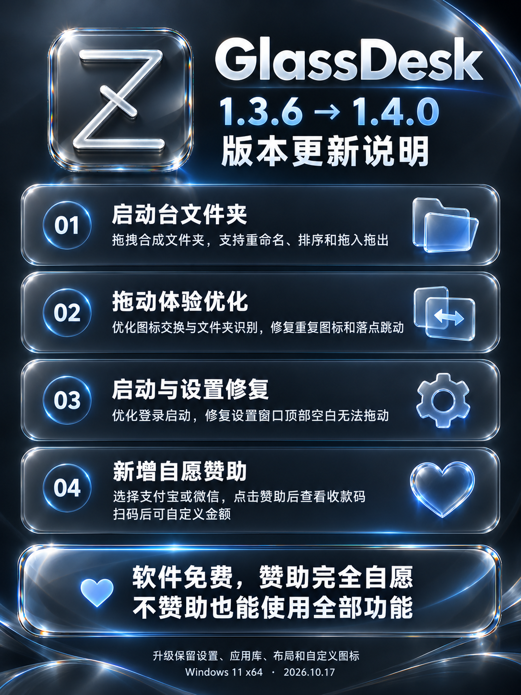

# GlassDesk 更新

[下载 GlassDesk 1.4.0](https://github.com/everlosttime/glassdesk-updates/releases/tag/v1.4.0)

从 1.3.6 升级至 1.4.0：

- 启动台支持拖拽创建文件夹，提供磨砂玻璃外观、重命名、内部排序、拖入和拖出。
- 优化文件夹悬停识别与图标交换，修复重复图标、松手落点跳动等问题。
- 优化当前用户登录启动，修复设置窗口顶部空白有时无法拖动的问题。
- 新增自愿赞助：选择支付宝或微信，点击“赞助”后才弹出对应收款码，扫码后可在手机端自定义金额。
- 软件免费，赞助完全自愿，不赞助也能使用全部功能。

升级保留设置、应用库、文件夹、布局、自定义图标与登录启动配置。

[完整更新说明](Release-notes-v1.4.0.md)

此仓库提供公开安装包、SHA256SUMS.txt、更新说明及更新内容图片。设置 → 关于 → 检查更新可获取最新稳定版；安装包不包含个人 Data。适用于 Windows 11 x64 Build 22000 及以上，内置 .NET 10。

[最新更新 API](https://api.github.com/repos/everlosttime/glassdesk-updates/releases/latest)

